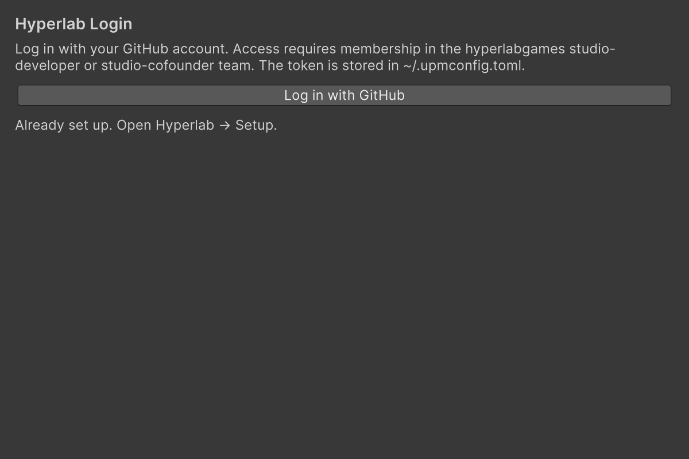

<!-- tür: tarif -->
# Registry'e giriş yap

> `Hyperlab → Login`: GitHub hesabınla giriş yapar, token'ı `~/.upmconfig.toml`'a yazar ve projeye Hyperlab registry'sini ekler.

## Hedef

Hyperlab registry token'ın makinene yazılır, projenin `Packages/manifest.json`'una `Hyperlab` scoped registry'si ve `com.hyperlab.setup` eklenir; paketler inince Setup sihirbazı açılır.

## Gerekenler

- GitHub hesabın `hyperlabgames` org'unun `studio-developer` ya da `studio-cofounder` takımında olmalı (değilse ekipten iste).
- Tarayıcıda açık bir GitHub oturumu.
- Hyperlab bootstrap paketi kurulu proje (boş projede Package Manager → Add package from git URL → `https://github.com/hyperlabgames/hyperlab-bootstrap.git`).
- Ağ erişimi; Play modu fark etmez ama proje açık olmalı.

## Adımlar

1. `Hyperlab → Login` menüsünü aç. `Hyperlab Login` penceresi açılır.

   

2. `Log in with GitHub`'a bas. Pencere `Waiting for GitHub in your browser…` yazar ve tarayıcı açılır.
3. GitHub'da `Authorize`'a bas (yalnız ilk seferde). Sayfa `You can return to Unity.` yazar.
4. Unity'ye dön. Başarıda pencere kendiliğinden kapanır, sonuç Console'a `Hyperlab Login: …` olarak yazılır. Hatada pencerede mesaj kalır (ör. hesabın takımda olmadığını söyleyen mesaj, zaman aşımı, `localhost:8239` portunun dolu olması, `Cannot reach the Hyperlab registry.`).
5. Paketlerin inmesini ve Unity'nin alanı yeniden yüklemesini bekle. Setup menüsü hazır olunca `Hyperlab → Setup` sihirbazı kendiliğinden açılır.

## Sonuç / doğrulama

`~/.upmconfig.toml` içinde `[npmAuth."https://upm.hyperlab.games"]` bölümü vardır, `Packages/manifest.json`'da `Hyperlab` registry'si ve `com.hyperlab.setup` görünür ve Setup sihirbazı açılır. Durumu komut satırından görmek için: `unity command bootstrap_status --project-path <proje>`.

## Varyasyonlar

- `Cancel` beklemeyi bitirir ve portu bırakır.
- Tarayıcı açılmazsa adresi elle aç: `https://upm.hyperlab.games/-/oauth/authorize/cli`.
- Token zaten varsa ve registry'ye `GET` 200 dönüyorsa pencere kendiliğinden açılmaz; manifest eksiği GitHub girişi olmadan tamamlanır. Menüden açınca token var ama manifest eksikse `Complete setup (token already stored)` düğmesi çıkar.
- Kurulum tamamsa pencere `Already set up. Open Hyperlab → Setup.` der; token yenilemek için yine `Log in with GitHub`'a basabilirsin.
- Agent ile: `unity command bootstrap_login --token_env <DEĞİŞKEN> --confirm true --project-path <proje>`.

## İlgili

- [Giriş ve login akışı](../giris.md): akış, hata tablosu ve kod API'si.
- `com.hyperlab.setup` → `Documentation~/tarifler/setup-penceresi.md`
